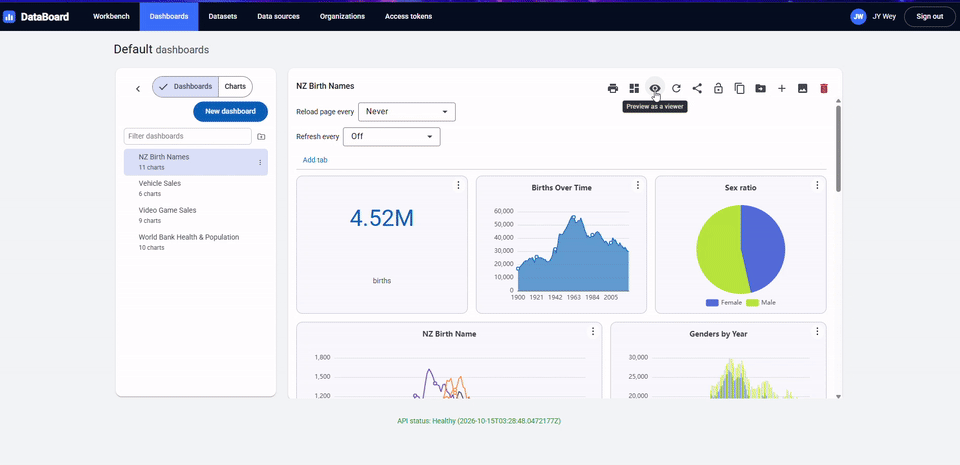
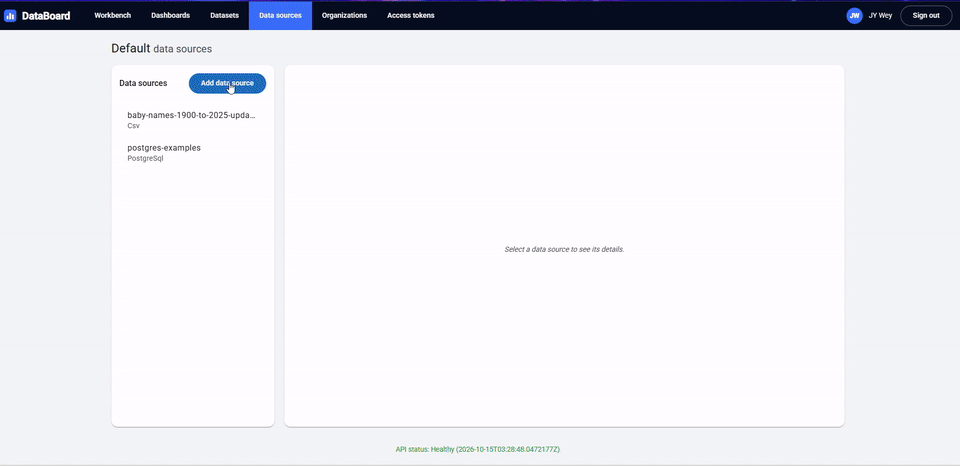

# DataBoard

**Turn your data into dashboards, without writing a line of code.**

DataBoard is a self-service business intelligence tool. Connect a database, define a dataset once, and your whole team can
build charts and dashboards from it, then share them with colleagues or with anyone through a link.

**Live site: <https://data-board.xyz>**. Create an account and try it.



## From a CSV file to a chart

Upload a CSV file, turn it into a dataset, and build a chart from it in a few clicks.



## What it does

- **Connect your data**: PostgreSQL, MySQL, SQL Server or a CSV file.
- **Prepare datasets**: write a read-only SQL query, or join tables step by step with no SQL.
- **Build charts**: pick fields, pick a chart type and see the result as you work. Bars, lines, areas, pies, heatmaps, scatter plots, word clouds, tables and single numbers.
- **Compose dashboards**: arrange charts, text and pictures on a grid, add tabs and filters that work across charts.
- **Share**: send a link, share with other organizations, download charts as CSV or PNG, or print to PDF.
- **Work together**: organizations with Owner, Editor and Viewer roles, and control over who sees each dashboard.
- **Ask an AI assistant to build it**: DataBoard speaks MCP, so an assistant such as Claude can create datasets, charts and dashboards from a plain-language request.

## Safe by design

People who can build charts should not be able to break your database. DataBoard checks every query before it runs:

- **User SQL is parsed, not pattern-matched.** It is read with a real SQL parser ([SqlParserCS](https://github.com/TylerBrinks/SqlParser-cs)) for each database dialect, and only a single read-only `SELECT` is allowed. Dangerous functions, file access and system tables are refused.
- **Charts are never written as SQL.** They are described as structured data, checked against the dataset, and turned into SQL by the server.
- **Values are never pasted into SQL.** Filters and parameters are always sent to the database as bound parameters.
- **Queries run read-only with a time limit.**

Built with ASP.NET Core (.NET 10), Angular and PostgreSQL.

## Try it

You need [Docker](https://www.docker.com/).

```bash
docker compose up --build
```

Open <http://localhost:8080> and sign in with the demo account `dev@databoard.local` / `dev-password-123`.
The demo account is only for trying it out on your own machine.

To let visitors try it without registering, set `Guests__Enabled=true`. The sign-in page then shows **Continue as guest**,
which opens a temporary account with a sandbox of its own, deleted after a day. Guests cannot connect databases, make
access tokens or share links.

## Deployment

DataBoard runs on a single small server. The `infra/` folder has everything to put it on AWS inside the free tier: a server
with automatic HTTPS and a managed PostgreSQL database, described with Terraform.

1. Copy `infra/terraform/terraform.tfvars.example` to `terraform.tfvars` and set your region and domain name.
2. Create the servers: `terraform -chdir=infra/terraform apply`.
3. Build and ship the app: `./infra/deploy.ps1`.

Point your domain at the server's address and the site comes up with a certificate. Full steps, costs, and how to update or
tear it down are in [`infra/README.md`](infra/README.md).

## License

MIT, see [`LICENSE.txt`](LICENSE.txt).
