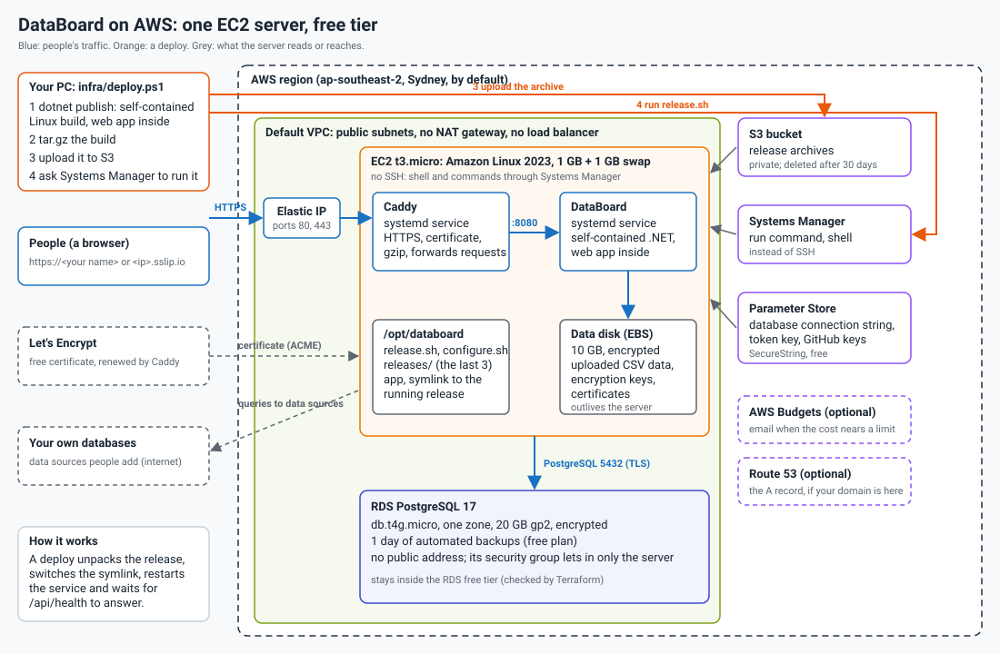

# Deploying DataBoard on AWS (EC2 free tier)

Terraform in `terraform/` builds a small stack that stays inside the AWS free tier; `deploy.ps1` builds the application as a
**self-contained** Linux program (the .NET runtime and the Angular app are inside it), uploads it, and starts it. There is
no Docker and no container registry.



The same thing as text:

```
 browser --HTTPS--> [ EC2 t3.micro ]  Caddy (certificate, HTTPS) --> DataBoard (systemd service, self-contained)
                         |   Elastic IP                                   |
                         |   data disk (uploads, keys, certificates)      |
                         '--------------------- port 5432 ----------------'--> [ RDS PostgreSQL, db.t4g.micro, one zone ]
 your PC --deploy.ps1--> S3 bucket (release archives) --> the server downloads and starts the newest one
```

| Part | What | Why this way |
|---|---|---|
| Server | One EC2 instance, Amazon Linux 2023, no SSH (use Systems Manager) | In the free tier. No load balancer (about $16 a month) and no NAT gateway (about $32). |
| Application | The self-contained `linux-x64` build, run by systemd (`databoard.service`) as its own user | Nothing but the OS to install; a deploy is "unpack, switch, restart". The last three releases stay on the disk. |
| HTTPS | Caddy (installed as a program, run by systemd), certificates from Let's Encrypt, renewed by itself | Free. Needs a name that points at the server (below). |
| Database | RDS PostgreSQL 17, `db.t4g.micro`, 20 GB, encrypted, 1 day of backups, one zone, not reachable from the internet | In the free tier. Only the server can connect. |
| Data disk | A 10 GB encrypted EBS disk holding uploaded CSV data, the encryption keys and the certificates | Outlives the server: replacing the server keeps your data. |
| Secrets | The database password and the token-signing key are generated and kept as SecureString parameters in Parameter Store | Free (Secrets Manager costs about $0.40 a secret a month). |
| Releases | A private S3 bucket; archives older than 30 days are deleted | 5 GB is free. |

The default region is **ap-southeast-2 (Sydney, Australia)**. Change `aws_region` in `terraform.tfvars` to use another
(for example `ap-southeast-4` for Melbourne). Prices there are a little higher than in the US regions; the free tier is the same.

## What you need

- An AWS account, and the AWS CLI signed in to it (`aws configure`, or `aws sso login`).
- Terraform 1.6 or later.
- To build on your PC: the .NET 10 SDK and Node 22.22+ or 24.15+ (publishing builds the Angular app), and `tar` (Windows 10 and later have it).

## Steps

```powershell
cd infra/terraform
copy terraform.tfvars.example terraform.tfvars      # optional: change what you want
terraform init
terraform apply                                     # about 10 minutes (the database takes the longest)

cd ../..
./infra/deploy.ps1                                  # builds the application, uploads it, starts it (a few minutes)
```

Then open the `app_url` that Terraform printed (`terraform -chdir=infra/terraform output app_url`), register, and you are in
the shared **Default** organization (the first account to register owns it; everyone after joins as an Editor). The first start applies the database migrations by itself.

To update the application later, run `./infra/deploy.ps1` again. For a Graviton (`t4g`) server, set `architecture = "arm64"`
in `terraform.tfvars` and run `./infra/deploy.ps1 -Runtime linux-arm64`.

## How to get a domain

Sign-in cookies need HTTPS, and HTTPS needs a name (certificates are not given to bare IP addresses). Three ways:

1. **Nothing to buy: the default.** With `domain_name` empty, the server is reached at a name made from its address,
   like `3-91-44-12.sslip.io`. That is a free service that turns such a name back into the address. HTTPS works. The
   downside: the name is ugly, and everyone shares sslip.io's Let's Encrypt allowance, so a certificate is occasionally
   refused (try again later, or use a domain of your own).
2. **A free subdomain** from a dynamic DNS service such as DuckDNS (`yourname.duckdns.org`): sign up, point the name at
   the `public_ip` output, and set `domain_name = "yourname.duckdns.org"`.
3. **Buy a domain** (a `.com` is about $10 to $15 a year). Registrars include Route 53 (AWS), Cloudflare Registrar (sells
   at cost), Namecheap and Porkbun. Then:
   - set `domain_name = "databoard.example.com"` in `terraform.tfvars`;
   - make an **A record** for that name pointing at the `public_ip` output, at wherever your DNS is. If the domain is in
     Route 53, also set `route53_zone_id` and Terraform makes the record itself;
   - run `terraform apply` (the server is replaced, which is quick and keeps your data), then `./infra/deploy.ps1`.
   Make the A record before the apply finishes if you can: Caddy asks for the certificate as soon as it starts, and it
   keeps retrying until the name answers.

## What it costs

The free tier changed in July 2025: an account made before 15 July 2025 gets 12 months of the free allowances; a newer
one gets a "free plan" of credits for six months. Check which applies to you under *Billing and Cost Management > Free
Tier*. In both cases this stack is made of the usual free-tier parts:

- EC2 `t3.micro` (750 hours a month), 12 GB root disk plus the 10 GB data disk (30 GB of EBS is free),
- RDS `db.t4g.micro`, single zone, 20 GB (750 hours a month),
- S3 (5 GB), Parameter Store standard parameters, Systems Manager: free.

**The database is kept inside the free tier by a check.** RDS is free for one single-zone micro instance (`db.t4g.micro`,
`db.t3.micro` or `db.t2.micro`) with 20 GB of general purpose storage and up to 20 GB of backups. Terraform refuses to plan
a different instance class or more than 20 GB (`db_instance_class`, `db_storage_gb`) unless you set
`allow_paid_database = true`, storage cannot grow by itself, and the paid extras (Performance Insights, enhanced monitoring) are off.
`terraform test` in `infra/terraform` proves this with no AWS account. One thing to know: if you set `protect_data = true`,
destroying the stack leaves a final snapshot of the database, which is billed (about $2 a month for 20 GB) until you delete it.

Not free, but small: **public IPv4 addresses are charged at $0.005 an hour** (about $3.60 a month for the server's), which
the free tier only covers for the first year of older accounts. After the free period, expect roughly $25 to $30 a month in
total (server, database, disk, address).

Set `alert_email` in `terraform.tfvars` to get a warning when the month's cost nears `monthly_budget_usd`.

## Operating it

- **Shell on the server** (no SSH): `aws ssm start-session --target <instance_id>`. Logs: `journalctl -u databoard`,
  `journalctl -u caddy`, `/var/log/databoard-bootstrap.log`.
- **Update the app:** `./infra/deploy.ps1`. **Undo a bad release:** on the server, point `/opt/databoard/app` at the
  previous folder in `/opt/databoard/releases` (`ln -sfn <folder> /opt/databoard/app`) and `systemctl restart databoard`.
- **Change a setting** (domain, GitHub sign-in, instance size): edit `terraform.tfvars`, `terraform apply`, then
  `./infra/deploy.ps1`. A change to the start-up script replaces the server; the data disk, the database and the address are kept.
- **Sign in with GitHub:** make an OAuth app at GitHub with the callback `https://<your host>/api/auth/github/callback`,
  and set `github_client_id` / `github_client_secret`.
- **Backups:** RDS keeps 1 day (`db_backup_days`; AWS free-plan accounts cannot keep more, a paid plan can raise it to 7 or more). The data disk (uploaded CSV data) is not backed up; take an EBS
  snapshot of it from time to time, or switch on AWS Backup.
- **Take it all down:** `terraform destroy`. `protect_data` is `false` by default, so the database is deleted at once with
  **no final snapshot: its data is lost**. For a stack you want to keep safe, set `protect_data = true`: then the database
  refuses to be deleted (set it back to `false` and `terraform apply` first), and a final snapshot is taken if it is.

## Good to know

- The server runs on 1 GB of memory (with 1 GB of swap). It is enough for a small team; for more, raise `instance_type`
  (`t3.small`) and `db_instance_class`.
- One server only: charts' result cache is in its memory, and uploaded data is on its disk. Running several would need a
  shared cache and storage first.
- The application is told to apply database migrations when it starts (`Database__MigrateOnStartup`). That is right for one
  server; with several, run the migrations as a step of their own instead.
- The encryption keys of the application (which protect stored passwords) are kept on the data disk
  (`DataProtection__KeysPath`). Lose the disk and stored data source passwords can no longer be read.
- The Terraform state file holds the generated passwords. Keep `terraform.tfstate` private, or use the S3 backend shown in
  `versions.tf`.
- Data sources that people add to DataBoard must be reachable from the server over the internet. A database in your own
  network is not, unless it accepts connections from the server's address (shown as `public_ip`).
- The database is not exposed. If you need to look at it, use `aws ssm start-session` to the server and connect from there.
